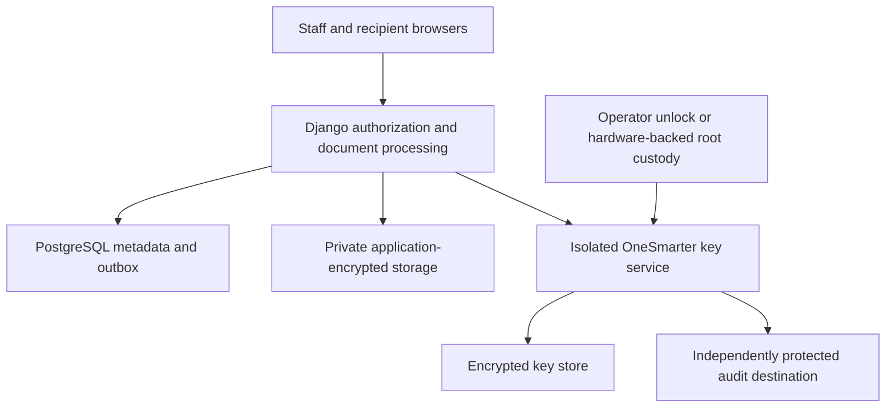

# OneSmarter key service — production target

Updated: 2026-10-28. Implemented synthetic candidate and production requirements; not independently audited. The user has excluded AWS KMS and OSIVault. This document owns the replacement service boundary; [KEY_MANAGEMENT.md](KEY_MANAGEMENT.md) describes the current candidate and migration obligations.

## Scope and trust

Build our own key-management orchestration, authorization, lifecycle and recovery using maintained cryptographic implementations. Do not invent AES, lattice arithmetic, elliptic-curve arithmetic, random generators, secret sharing or a new hybrid combiner. Standardized primitives do not certify their composition. Production remains blocked until the exact protocol and implementation receive independent review.

The product backend remains a modular monolith. A separately isolated key service is justified specifically to keep persistent organization private keys out of the web process. A separate host and independent administration provide a stronger boundary than two containers on one host. Host administrators and authorized key custodians remain within the trust model.

The service performs hybrid DEK wrapping/unwrapping and migration. Django handles document authorization, scanning and AES-GCM document processing. It receives a DEK temporarily for an authorized read; it never receives the persistent organization private keys or root key through a runtime API. A compromised Django workload can still misuse the unwrap authority granted to it. Isolation limits exposure, not all compromise consequences.

## Key hierarchy and responsibilities

| Material | Creation and persistence | Permitted exposure |
| --- | --- | --- |
| Document DEK | Fresh cryptographically random 32 bytes per encrypted value/file; persisted only wrapped | Temporary document-processing and key-service memory |
| Temporary KEK | Derived by the approved hybrid protocol for each wrapper; not persisted | Key-service memory only |
| Organization wrapping version | ML-KEM-768 and X25519 key material; public metadata and encrypted private material in the key store | Private material stays within the key service |
| Root protection key | Generated/protected through the approved custody procedure | Custody boundary; never a portal/browser API response |
| Workload identity credentials | Separate from encryption keys, scoped to service operations/organizations | Authenticated service processes; short-lived where supported |

Public keys need authenticated provenance and organization/version binding even though they are nonsecret. Key IDs are identifiers, not permissions. Tenant context supplied in a request must be checked against the authenticated workload's permitted scope.

## Selected custody: operator unseal webpage

A dedicated custodian uses the maintenance webpage, a provisioned browser client certificate and a separate password. Login works while the key store is sealed. The operator enters a randomly generated 32-byte Base64 recovery secret; this decrypts the root into the key-service process memory. The recovery value is not intentionally persisted by the request handler. Encrypted root/private material stays on disk. Logout/session expiry leaves the service unsealed; explicit Seal or process restart seals it. Document ciphertext is not deleted or bulk decrypted.

This is single-operator custody, not a quorum or hardware-backed design. The same human may be a portal administrator and custodian, but those are separate grants. No ordinary staff/admin account implicitly receives custody authority. The production assignment of custodians, recovery storage, restart availability and emergency process still requires approval.

Python and browser runtimes cannot guarantee secret zeroization. Disable/restrict dumps, swap, tracing, request-body capture and session replay in deployment. Protect the custodian browser and machine; an unsealed software service remains vulnerable to privileged host compromise. Do not keep the recovery secret beside the encrypted store or in application environment variables. See [KEY_SERVICE_OPERATIONS.md](KEY_SERVICE_OPERATIONS.md).

## Internal operation contract — not public endpoints

| Operation | Inputs and authorization | Output / failure behavior |
| --- | --- | --- |
| Wrap DEK | Authenticated workload, organization/resource context, approved suite and DEK; active version selected consistently | Versioned wrapper; no persistent private material |
| Unwrap DEK | Scoped workload, validated envelope and trusted expected context | DEK only after authentication; generic failure on invalid input; audit safe identifiers |
| Rewrap DEK | Organization-scoped workload identity explicitly granted `rewrap`, source envelope, expected destination/version | Replacement wrapper without exporting DEK; preserve content ciphertext |
| Create/activate version | Separate administrative identity, reason, organization and expected active version | Atomic activation, previous version decrypt-only; verify generated material before activation |
| Status | Least-privilege operational identity | Readiness, public version/suite metadata and migration health; no secrets |

The implemented `/v1/` service uses explicit operation allowlists. Workload defaults include wrap, unwrap and rewrap; maintenance defaults include rotate and import. Custodian login alone does not grant runtime operations. Continue reviewing versioned schemas, size bounds, error codes, workload identity bootstrap, channel authentication, request replay/idempotency handling, quotas and timeouts. Administrative and runtime permissions must be separate; portal account administrators do not inherit key-custodian privileges. There is no public arbitrary-decrypt or raw-private-key export endpoint.

Use authenticated protected transport. Mutual authentication alone does not establish post-quantum confidentiality: verify the negotiated approved hybrid key exchange on any connection carrying DEKs or private material. Avoid persistent secret caches initially; introduce caching only with explicit residency, revocation, outage and audit tradeoffs.

## Cryptographic contract

- AES-256-GCM encrypts document bytes with a fresh random DEK and 96-bit nonce, a full 128-bit tag, and trusted organization/resource/purpose context. Never repeat a key/nonce pair for a new encryption invocation. Return plaintext only after authentication.
- Each wrapping operation supplies fresh ML-KEM encapsulation randomness and an ephemeral X25519 contribution as specified by the selected protocol. Validate encodings, lengths and unusable shared values. ML-KEM implicit rejection is not a substitute for authenticated wrapper verification.
- Choose an independently reviewed exact hybrid profile; freeze its version, combiner, KDF/domain separation, encoding and associated-data rules. The current project-specific HKDF composition is a candidate, not X-Wing, HPKE or a TLS suite. Do not copy a TLS combiner out of its transcript context or silently change existing suite semantics.
- Nonces, public values and encapsulation ciphertexts may accompany the wrapped DEK. Readable DEKs, shared secrets, KEKs and persistent private material must not enter logs, Redis jobs, tracing or browser storage.
- Unsupported versions, missing PQ components and unknown algorithms fail closed. No classical fallback, alternate root-only DEK recovery wrapper or legacy compatibility path may silently bypass the approved hybrid requirement.
- Hybrid protection is conditional on the exact construction; security strengths do not add. Ephemeral X25519 does not provide forward secrecy for envelopes recoverable by retained persistent private keys. This remains trusted-server encryption, not zero-access E2EE.

## Mandatory PQ scope

Implementation: [PQ_TRANSPORT.md](PQ_TRANSPORT.md) defines the strict `X25519MLKEM768` TLS profile, Python runtime requirements, candidate HTTPS edge, scanner gateway and backup adapter. Local negotiated-group and downgrade tests are implemented; full deployment coverage and independent approval are still required. Do not equate development mode with enforced PQ transport.

| Path | Release requirement |
| --- | --- |
| Stored content and key wrappers | Reviewed hybrid key protection and AES-GCM content protection; sensitive fields and MFA/delivery secrets included with purpose separation |
| Recipient upload / staff download | Verify all plaintext-bearing browser, ingress and internal transport hops |
| Django / workers to key service | Verify authenticated PQ-protected channels carrying DEKs and administrative private material |
| Scanning | Isolate plaintext processing; protect a remote scan hop to the same required standard |
| Backup and recovery | Encrypted key/data backups, tested custody and protected recovery paths |
| Notifications | No confidential bodies/files; scope credential exposure and expiry explicitly; ordinary-email Nophi traffic is outside confidential-portal protection |

Authentication/signature assumptions and active quantum threats need separate review. Do not claim every SMTP hop is PQ protected. Unsupported client/transport paths keep the release blocked until resolved; no misleading badges or silent downgrade.

## Rotation, recovery and long-term documents

Key versions: active for new writes, decrypt-only for retained documents/backups, and eventually retired/destroyed only through an explicitly approved process. No automatic key deletion based on visitor expiry or age. One active version per organization; serialize activation and coordinate destination-version checks with migrations.

Rewrapping preserves the DEK, content nonce and content ciphertext. Generate and verify a replacement wrapper, write a new object where needed, then atomically update its reference. Retries must be safe; worker interruption leaves a valid source or destination. Retained old objects require controlled cleanup, not session-based deletion.

Root rotation is separate from organization-key rotation. It changes protection of persistent private material. Use staged, verified, resumable migration with a tested rollback/recovery path; never overwrite the only root or delete old material before retained backups are recoverable. Rewrapping does not repair historical copies already exposed with compromised keys.

Back up object versions, metadata, encrypted private material, manifests, required formats/dependencies and custody recovery information. Keep recovery authority separately protected. Test isolated restore with actual selected custody hardware or custodian quorum, missing/incorrect shares, damaged backups and service restarts. RTO/RPO and acceptable manual-unlock delay remain open.

Committed visitor files have no automatic age-based deletion; storage and key lifecycle must preserve their readability independently of sessions. See [DATA_RETENTION.md](DATA_RETENTION.md).

## Migration from current code — required before release

1. Approve custody and freeze/review the hybrid protocol and internal contract.
2. Implement the isolated service, scoped identities, root lifecycle and protected audit path. Keep synthetic development explicitly separate.
3. Replace the application's direct private-key recovery with the internal wrapping service. Preserve format-version compatibility only where explicitly permitted and tested.
4. Remove AWS KMS deployment settings/runtime dependencies and the legacy protector after inventorying any encrypted records. No live KMS data is evidenced; do not assume none exists at migration time. Existing data must never be stranded by deleting its only protector.
5. Replace S3 `aws:kms` requests in both document storage and audit archive adapters. Proposed AWS-storage fallback is SSE-S3 (`AES256`) plus application encryption, without a customer AWS KMS dependency; verify final bucket policy and every storage integration. AWS compute/S3 remain separate from the rejected KMS service.
6. Replace legacy KMS-only tests and readiness text with self-managed custody/service tests. Remove any automatic cloud fallback. Verify container/CI/deployment configuration also needs no KMS credentials, APIs or permissions.
7. Complete independent review, interoperability, concurrency, failover, sealed-state and restoration evidence before enabling production.

## Evidence required

Independent authoritative primitive vectors and a separate reference implementation for the frozen envelope profile; malformed/unknown-suite rejection; cross-organization and purpose-binding tests; repeated/replayed request handling; compromised/stale workload credentials; sealed and unavailable service behavior; key-loss and root-rotation recovery; concurrent reads/uploads/rotation; interruption at every migration boundary; log/queue/dump leakage review; measurable transport negotiation and operations alerts.

Passing local roundtrips is not approval. See [TESTING.md](TESTING.md), [RELEASE_GATES.md](RELEASE_GATES.md) and [ROADMAP.md](ROADMAP.md) for evidence versus outstanding work.

## References

- [NIST FIPS 203](https://csrc.nist.gov/pubs/fips/203/final), [NIST SP 800-227](https://csrc.nist.gov/pubs/sp/800/227/final), [RFC 7748](https://www.rfc-editor.org/rfc/rfc7748.html), [RFC 5869](https://www.rfc-editor.org/rfc/rfc5869.html).
- [X-Wing revision 11](https://www.ietf.org/archive/id/draft-connolly-cfrg-xwing-kem-11.html): a distinct September 2026 draft, not our current candidate.
- [OWASP key management](https://cheatsheetseries.owasp.org/cheatsheets/Key_Management_Cheat_Sheet.html), [Vault seal/unseal](https://developer.hashicorp.com/vault/docs/concepts/seal): review guidance and an architectural reference, not a new product dependency.

## Delivered candidate versus remaining target

The separate service, browser operator unlock, scoped mTLS operations, local-version import, transactional root rotation and encrypted-backup restoration are implemented. Runtime AWS KMS settings/protector and SSE-KMS requests are removed. The rollout sequence above remains an inventory/validation obligation for any actual deployment; it is not a statement that removed code is still present. Single-process SQLite is the candidate store, not a highly available production deployment. See [KEY_SERVICE_OPERATIONS.md](KEY_SERVICE_OPERATIONS.md) for exact commands, API fields, limits and release gaps.
