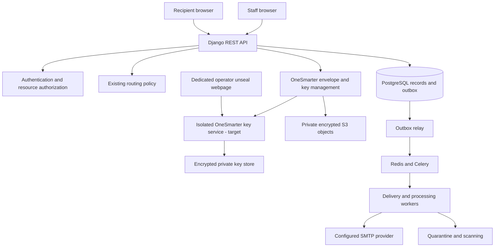

# OneSmarter Secure Mail — Architecture and Tools

Updated: 2026-10-28. Decisions and open questions: [PRD.md](PRD.md#decision-register).

## Document-storage decision - 28 October 2026

Uploaded documents will be stored on persistent disk attached to the AWS instance running the application. This supersedes private S3 as the primary attachment-storage baseline. Engineering assumption: use a dedicated persistent EBS data volume, mounted outside the application/container filesystem, with deletion on instance termination disabled and mount availability checked before accepting writes. Files remain application-encrypted and are served only through authorized application endpoints, never as public static files.

This selects storage placement, not an AWS geographic region. Region, volume sizing, backup destination/schedule/retention and recovery targets remain undecided. A backup on the same instance is not sufficient protection against loss of that instance. Retained conversation records, files and usable keys must be recoverable together. Keep the key-service custody boundary and separately held recovery secret; this decision does not authorize placing recovery secrets beside uploaded files.

AWS-managed EBS volume encryption uses AWS KMS, including its default managed key. Do not silently enable it while claiming zero KMS dependency. Application encryption remains required; the OS/volume encryption approach must be reviewed against the no-KMS requirement before deployment. See [AWS EBS encryption](https://docs.aws.amazon.com/ebs/latest/userguide/ebs-encryption.html). No AWS resources or encryption settings were changed by this documentation update.

The existing S3 adapter is optional, not the selected primary attachment backend. Immutable audit archival and off-instance backups are separate decisions; this change does not claim local disk provides Object Lock or host-admin-proof immutability.

## Existing implementation

- Python 3.12, Django 5.2.18, DRF 3.18.3, cryptography 50.0.2, django-otp, Celery, psycopg and boto3 are pinned in `requirements.lock`.
- React 19.3.1, strict TypeScript 7.0.2, Vite 8.3.5 and Playwright are pinned in `frontend/package-lock.json`.
- `backend/apps/core/` implements authentication, accounts, conversations, recipient verification, storage, delivery, audit and our own key-management modules.
- `frontend/src/` is the live React portal. `web/` remains the historical static visual prototype.
- Native development uses isolated SQLite and encrypted local objects. Compose targets PostgreSQL 17 and Redis 7.4; PostgreSQL remains the production database baseline.
- SMTP, S3 and ClamAV adapters are present. AWS KMS runtime protector/settings are removed; S3 storage/archive use SSE-S3. No live external integration is configured.
- OSIVault has been removed from the architecture by explicit user instruction. See [KEY_MANAGEMENT.md](KEY_MANAGEMENT.md) and [RELEASE_GATES.md](RELEASE_GATES.md).

## Target stack

The user selected this implementation baseline. Do not mix in another backend or frontend framework without a documented reason and decision. Exact versions are pinned in the checked-in lockfiles; update them deliberately and rerun compatibility checks.

| Layer | Baseline | Boundary |
| --- | --- | --- |
| Backend language | Python 3.12+ | Pin one supported minor and current patched image for reproducibility |
| Backend framework | Django 5.2 LTS | Modular monolith; latest compatible security patch in the 5.2 line |
| API | Django REST Framework | Validate compatibility with chosen Django/Python versions and pin it |
| Frontend | React 19 + strict TypeScript | Separate browser application; Vite build tool installed and production build verified |
| Styling | Semantic CSS variables and layered stylesheet | Follow DESIGN_SYSTEM.md; no Tailwind/component suite is required by the prototype |
| Browser state | React local state; context only for small shared non-sensitive state | No Redux/Zustand baseline; no persistent plaintext content cache |
| API access | Typed fetch wrapper and feature hooks | Credentials/CSRF, cancellation, consistent errors; add a query library only for a concrete need |
| Durable records | PostgreSQL | Django ORM, constraints, transactions; PostgreSQL 17 pinned in local Compose and CI |
| Background jobs | Celery + Redis | Database outbox remains authoritative; broker is not the sole durable record |
| File storage | Persistent data volume on the AWS application instance | Application-encrypted private attachments; dedicated EBS mount proposed; region, backups and no-KMS-compatible volume protection pending |
| Key management | Isolated OneSmarter key service | No AWS KMS/OSIVault dependency; scoped workload identities, protected root custody, versioned envelopes and tested recovery; synthetic implementation delivered; production approval pending |
| Immutable audit archive | Dedicated versioned S3 archive with Object Lock proposed | Protected canonical records plus PostgreSQL search projection; retention/mode approval and enforcement evidence required |
| Cryptography | OneSmarter-owned v2 hybrid envelopes | Cryptography 50.0.2 primitives; ML-KEM-768 + X25519 + HKDF-SHA-256 + AES-256-GCM; independent protocol review pending |
| Development | Docker / Docker Compose | Reproducible dependencies; no production credentials or confidential data |
| Production | AWS | Compute, region, network layout, database/broker service, TLS termination still open |
| CI | GitHub Actions | PostgreSQL backend checks and frontend build/dependency checks configured; remote execution not yet observed |

Django 5.2 is an LTS release and supports Python 3.12. Confirm the chosen DRF release against its compatibility list. See [Django 5.2 release notes](https://docs.djangoproject.com/en/5.2/releases/5.2/) and [DRF requirements](https://www.django-rest-framework.org/#requirements). React 19 is the chosen major; pin a supported patch using the [official versions page](https://react.dev/versions). Celery documents Redis integration, but retry/visibility settings must be tested for the application's jobs: [Celery Redis documentation](https://docs.celeryq.dev/en/stable/getting-started/backends-and-brokers/redis.html).

## Architecture and responsibilities

The business application remains a modular monolith with web/API and background workers. The proposed isolated key service is a specific security boundary: persistent organization private keys remain outside the web process. Separate hosts/administration provide stronger isolation than same-host processes. Prefer same-origin frontend/API delivery to simplify cookies and CSRF; different-origin deployments must configure CORS and cookies explicitly. See [KEY_SERVICE_ARCHITECTURE.md](KEY_SERVICE_ARCHITECTURE.md) for operations and outstanding production custody approval.

Keep policy, permission checks, crypto operations, provider transport, and business workflows separate. UI route previews are advisory; the server always recomputes before delivery.

## Data and API boundaries

Proposed records: Organization, StaffUser, SenderAddress, Conversation, Message, RecipientGrant, Attachment, OTPChallenge, RecipientSession, DeliveryJob/OutboxEvent, AuditEvent, CryptoKeyReference. Enforce foreign keys, organization scoping, idempotency uniqueness, and indexes for authorized owner/status/expiry/time queries. Avoid N+1 reads with explicit relation loading.

Keep delivery, access, conversation, OTP, and attachment states independent. SMTP acceptance is not proof of delivery or reading. A resend must not revive revoked grants.

| API proposal | Responsibility |
| --- | --- |
| `POST /api/conversations` | Validated staff compose/request; route and persist |
| `GET /api/conversations` | Authorized list/search/filter/pagination |
| `GET /api/conversations/{id}` | Authorized staff conversation |
| `POST /api/conversations/{id}/messages` | Idempotent staff reply |
| `POST /api/conversations/{id}/revoke` | Authorized and audited revocation |
| `POST /api/invitations/{token}/code` | Code issuance to fixed grant mailbox |
| `POST /api/invitations/{token}/verify` | Atomic code consumption and scoped session |
| `GET /api/recipient/conversation` | Current recipient-session scope |
| `POST /api/recipient/replies` | Idempotent recipient submission |
| `POST /api/attachments` | Authorized upload into quarantine workflow |
| `GET /api/attachments/{id}` | Current authorization and scan-state check |
| `POST /api/recipient/logout` | Session invalidation |

The table above is the earlier route proposal; implemented route names and schemas are in [API_REFERENCE.md](API_REFERENCE.md). Do not treat proposed names as implemented endpoints. API errors must not disclose whether an unauthorized conversation exists. Search remains over approved operational metadata; do not index plaintext confidential content to make search easier.

## Storage, transactions, and background delivery

Commit business records and an outbox entry together in PostgreSQL. Relay committed work to Celery and make each job safe to retry with database-backed status, deduplication, bounded backoff, and reconciliation.

S3 writes cannot participate in the PostgreSQL transaction. Use staged private objects, explicit attachment states, a finalization step, and orphan cleanup. Never expose incomplete or unscanned objects.

Committed visitor files persist on the same conversation without automatic age-based deletion. Session timeout, logout, grant expiry and revocation end access, not storage retention. Orphan cleanup must exclude committed objects and coordinate with finalization; preserve staff reads after access ends. See [DATA_RETENTION.md](DATA_RETENTION.md).

The no-AWS-KMS requirement includes storage and audit: both adapters now request SSE-S3 (`AES256`) alongside application encryption. Verify actual bucket policy and every deployment/backup integration before release.

Store job references rather than plaintext bodies/files in the broker. OTP dispatch needs a reviewed short-lived secret lifecycle: a verification hash cannot reconstruct the code for sending. Keep any required delivery copy separately encrypted and time-limited, reference it from the job, and remove it when no longer needed; do not log or put raw codes in queues.

Submission idempotency does not create exactly-once SMTP delivery. A timeout after provider acceptance can leave an uncertain outcome; record it and reconcile or apply controlled retry instead of promising no possible duplicate notification.

## Authentication and authorization

The user selected application-managed staff accounts with MFA (D05). Use Django's established account/password/session capabilities and a vetted MFA implementation; factor type, enrollment, recovery, and exact compatible package remain to be selected. Django alone is not an implementation of MFA. Recipient email codes prove mailbox control only and create grant-scoped sessions, not unrestricted user accounts.

Staff provisioning is administrator-managed; disable public staff registration. Share the normal portal/login and add permission-protected Access → Accounts / Audit logs pages. Define explicit account-management, privilege-management, usage-view, audit-read, and audit-export capabilities; administrators receive the approved management set without global conversation-content access. Audit readers do not automatically become account managers.

Activation invitations are hashed, expiring, single-use and bound to the account/mailbox; account creation plus invitation outbox insertion is transactional and idempotent. Require password setup and MFA enrollment before activation permits protected use. Record last successful login only after the complete required authentication flow, rather than relying on a pre-MFA signal. Keep account status, invitation status, lockout, and MFA enrollment distinct.

Use transactional permission changes and last-active-admin protection, including concurrent requests. Suspension/deactivation invalidates sessions, prevents further operations, and causes workers to reject unauthorized pending sends. Privilege changes must invalidate or re-evaluate stale authorization caches. Require recent MFA and a recorded reason for sensitive changes; recovery must use a vetted verified process. Bootstrap the first administrator through restricted deployment tooling with an audit event, never public registration.

Nophi is restricted to explicitly permitted staff (D06). The existing routing function has no permission argument and is not sufficient enforcement. Proposed behavior for an unauthorized override on a new ordinary conversation is API rejection before delivery; protected requests/threads retain their higher precedence. Implement and test this integration without silently broadening routing rules.

Use cryptographically generated codes, keyed verification values, atomic single consumption, expiry, attempt limits, and aggregate issuance throttles. Store invitation-token hashes; redact raw tokens from request logs and referrers. Link GET requests never unlock content.

Use Secure, HttpOnly, appropriate SameSite session cookies; CSRF protection for state changes; strict server-side sender, organization, conversation, and attachment authorization. Clear sensitive client state on logout/expiry; use no-store responses for protected content. Administrator access remains explicit, not inherited from management permissions.

## Administration API and usage model

The following are proposed contracts, not live endpoints. Every call checks organization scope and a specific administrative capability; profile updates use field allowlists and cannot silently change role, email, MFA, or account status.

| API proposal | Responsibility |
| --- | --- |
| `GET /api/admin/accounts` | Search/filter/order/paginate permitted account and usage summaries |
| `POST /api/admin/accounts` | Idempotent staff creation and activation invitation |
| `GET /api/admin/accounts/{id}` | Safe profile, security/lifecycle metadata, permitted actions |
| `PATCH /api/admin/accounts/{id}` | Allowlisted profile edits with concurrency protection |
| `POST /api/admin/accounts/{id}/permissions` | Explicit role/sender/Nophi change with privilege checks and audit |
| `POST /api/admin/accounts/{id}/status` | Validated suspension/reactivation/deactivation transition and reason |
| `POST /api/admin/accounts/{id}/invitation` | Authorized resend/cancel; invalidate superseded activation secrets |
| `POST /api/admin/accounts/{id}/recovery` | Initiate approved password/MFA recovery; never return secrets |
| `POST /api/admin/accounts/{id}/revoke-sessions` | Invalidate current staff sessions |
| `GET /api/admin/accounts/{id}/usage` | Defined period counts and timestamped current gauges |
| `GET /api/admin/audit-events` | Read-only scoped search/filter/order/pagination |
| `GET /api/admin/audit-events/{id}` | Redacted event details and archive/integrity evidence |
| `POST /api/admin/audit-exports` | Authorized, audited export job for a fixed filter/snapshot |
| `GET /api/admin/audit-exports/{id}` | Job status; authorized short-lived download when ready |

Activation, login-mailbox changes, and verified recovery need separate public/session contracts during auth design. No account hard-delete or audit update/delete endpoint is part of this baseline. The audit-export POST creates a job; it never changes historical events.

Extend the proposed data model with StaffInvitation, StaffSession/session-revocation state, permission grants, usage aggregates, AuditArchiveBatch/Manifest, and AuditExportJob as required. Use stable staff IDs and preserved event attribution; do not cascade-delete audit history when a profile changes. Separate export/archive delivery status from immutable event bodies.

Use server-side allowlists for sort keys and search fields, parameterized ORM queries, bounded date windows/page sizes, explicit null ordering, and a unique ID tie-breaker. Account search covers approved name/email/ID fields; audit search covers the allowlisted PRD metadata. Design indexes from organization + timestamp/actor/action/outcome queries; do not add plaintext content indexes. Use an as-of high-water mark or snapshot-bound cursor for log browsing and exports so new events do not cause unstable pagination.

Compute usage from durable unique business records/events, not HTTP request counts or SMTP retry attempts. Record historical receiving-owner attribution at submission time; show current retained bytes and current assignments as separate timestamped gauges. Include deduplicated object versions/quarantine in physical retained-byte totals, avoid per-account double counting in organization totals, and do not present this as billing. Use indexed aggregation or refreshed summary tables without N+1 queries; return the measured period, timezone, freshness watermark, and unknown/not-yet-measured values explicitly.

## Immutable audit architecture

Proposed layers:

1. **Durable event journal:** business/security mutations append an audit event in the same database transaction. Application roles have no update/delete access to event bodies; restrict database privileges and add defense-in-depth rejection of mutations. Database superusers remain outside that guarantee.
2. **Protected canonical archive:** a restricted worker writes events/batches with stable IDs, sequence coverage, schema version, and digest manifests to a dedicated versioned S3 archive. Proposed enforcement is Object Lock compliance mode for an approved finite interval, with separate operational credentials. This is a proposal requiring D15 approval, not a storage configuration already enabled.
3. **Search projection:** PostgreSQL provides fast redacted account/event queries; reconcile it with archived event IDs, counts, sequence coverage and manifests. Rebuild a damaged projection from the archive. A mutable index is not itself the immutable evidence source.
4. **Verification and operations:** monitor archive acknowledgements, the last verified watermark, event gaps, reconciliation failures and key recovery. Cryptographic integrity evidence is additional protection, not a substitute for enforced retention or proof that an originally recorded event was truthful.

S3 Object Lock protects specific versions, requires versioning, and permits creation of newer versions; archive retrieval must therefore retain exact version references. Compliance-mode retention prevents protected-version changes/deletion during the interval, whereas governance mode can be bypassed by specially authorized principals. [AWS Object Lock documentation](https://docs.aws.amazon.com/AmazonS3/latest/userguide/object-lock.html).

Keep archive decrypt/recovery keys available for the full approved retention and restore horizon. Object Lock does not prevent encryption-key deletion from making records unreadable. [AWS Object Lock considerations](https://docs.aws.amazon.com/AmazonS3/latest/userguide/object-lock-managing.html). Separate archive retention from message access expiry and from ordinary application content deletion; retention duration and region remain unresolved.

Do not expose archive delete, retention-shortening, or privileged key-management operations to portal administrators. Record corrections as new linked events. If an event awaits archival, label it Pending archive rather than claiming it is storage-locked. If a business/security mutation cannot durably record its required event, reject/roll back that mutation. Failures occurring outside a business transaction need an independent durable recording path; do not silently lose failed-login/denial events. Define and test the maximum acceptable unarchived window and outage behavior before production (D15); protect and retain the pending journal until archival is confirmed. Database append-only protections alone do not close the pre-archive infrastructure-compromise window.

Logs and exports contain only approved metadata. IP/device data require explicit minimization/retention approval; no geolocation or device fingerprinting baseline. Search/filter audit records use safe structured parameters, not raw unbounded user-entered strings. Audit user-initiated log reads/detail views and exports through a dedicated path; exclude internal audit-writer/reconciliation operations from recursive audit-read generation while recording their health separately.

Exports must fix the permitted field set, filter and as-of boundary; recheck authorization at generation and download, expire/delete export copies under approved policy, and prevent spreadsheet formula injection in CSV output. Keep exports separate from immutable canonical records; an expiring export is not the archive. Sensitive administration operations require actual IAM/database/storage rejection tests and backup/restore evidence before any immutable-history claim.

## OneSmarter-owned encryption and keys

The production target owns encryption orchestration and key lifecycle with no AWS KMS or OSIVault dependency. Standard algorithm implementations come from maintained, pinned libraries. The isolated service and operator webpage are implemented for synthetic use; independent review and production custody approval remain required.

`crypto.py` generates a fresh AES-256-GCM data key and nonce for each encrypted value. Version 2 wraps that DEK using a temporary KEK derived with HKDF-SHA-256 from real ML-KEM-768 encapsulation plus ephemeral X25519 exchange. Trusted resource context and wrapper metadata are authenticated. Unknown suites and modified ciphertext fail closed.

`keyring.py` currently maintains active tenant-scoped wrapping versions and decrypt-only older versions. Its AWS KMS seed protector is removed; key-service mode mirrors authenticated public metadata only; native synthetic development uses an ignored root-key file that is not acceptable production custody. The target key service keeps persistent private material internally and returns only scoped operation results/DEKs to authorized workloads. Public metadata needs integrity checks. Portal admins never receive raw keys; account management is not key custody.

Rotation activates a new version atomically and preserves old reads. `rewrap_keys` migrates stored DEK wrappers in resumable batches without changing the content ciphertext or content nonce. File migration writes a new private object before changing its database pointer. Old key versions remain available for backups; no automatic key-destruction operation exists.

The application handles plaintext and temporary DEKs during authorized processing, including scanning. This is not zero-access or client-to-client E2EE. Real ML-KEM use is not a claim that the custom combiner, transport or future key service has passed independent review. Freeze an approved hybrid profile and canonical context/encoding; never relabel the candidate as X-Wing or silently change existing suite semantics. Apply AES nonce/tag requirements from KEY_MANAGEMENT.md.

See [KEY_MANAGEMENT.md](KEY_MANAGEMENT.md) for current candidate mathematics and [KEY_SERVICE_ARCHITECTURE.md](KEY_SERVICE_ARCHITECTURE.md) for the production target, custody, isolation and migration plan. The AWS KMS and OSIVault plans are superseded.

## Mandatory post-quantum production gate

Do not release to production until security review accepts genuine PQ protection for the explicitly approved scope. Define algorithms and parameters, key establishment versus signatures, supported clients, known-answer/interoperability tests, downgrade rejection, key lifecycle, and migration evidence.

Evaluate stored content/key protection, every plaintext-bearing browser/ingress hop, application-to-key-service transport, remote scanning, and backup/recovery separately. Verify actual negotiated PQ protection; mutual TLS alone is insufficient evidence. Generic email notifications and the Nophi ordinary-email route have distinct scope/credential risks; do not claim every SMTP hop is PQ protected. Authentication/signature assumptions require separate review. Unsupported paths block release rather than silently downgrading.

## SMTP integration

Use the organisation-configured TLS SMTP submission server and each owning staff member's encrypted credential. SMTP submission is sending-only and is not end-to-end encrypted. No shared Proton or environment-password fallback is used.

Protected traffic sends generic invitations, codes, and staff notifications only. Eligible normal routes send ordinary message content through the approved transport. No recipient secrets in notification URLs beyond the opaque invitation token. Direct Proton web/mobile composition bypasses this application's policy; no interception API or partnership is assumed.

## Environments, operations, and validation

| Environment | Requirements |
| --- | --- |
| Development | Synthetic data, local dependencies, explicit fake mail transport, no production secrets |
| Staging/pilot | Isolated resources and self-managed key store/custody, dedicated test mailboxes, synthetic documents, fault/restore testing; no AWS KMS dependency |
| Production | Approved region/retention, reviewed PQ architecture, restricted service identities, real delivery monitoring, backup/restore and rollback readiness |

Use nonsecret environment configuration and an approved secret provisioning/custody process; use workload identity for AWS storage access where applicable. Root keys/unlock shares must not be placed in `.env`, images or application configuration. Never place credentials in frontend bundles, Dockerfiles, repositories or logs. Keep examples credential-free.

Track queue delay/failure, delivery uncertainty/bounces where supported, OTP abuse, scan failures, key failures, access denial, and restore health without sensitive payloads. Define alert ownership and D12 targets before launch.

Verification commands and observed results are in README.md and ROADMAP.md. Backend pytest tests, Ruff, Django checks, the TypeScript/Vite build and Playwright end-to-end flow are runnable. Live PostgreSQL concurrency, AWS/Proton/ClamAV integration and production restore checks remain release evidence, not implied passes.

Tradeoffs: a modular monolith limits operational complexity; server-managed keys simplify recipient access but trust the backend; metadata-first search limits leakage but offers less search functionality; outbox/queue workers improve reliability but need operational monitoring.

Current SMTP selection: organisation-managed server settings with individual staff credentials entered through Connections. The local common server is smtp.ionos.com:587 with STARTTLS. Provider authentication is pending staff credential entry. See ENVIRONMENT.md.

## Antivirus implementation update — 2026-10-28

Real ClamAV is the default for uploads; synthetic scanning requires explicit development/test configuration. Compose provides an isolated Unix socket, persistent signature updates and resource limits. The application checks loaded signature age before accepting a scan and rejects unavailable/stale/invalid results. Accepted files are encrypted after scanning. See [OPERATIONS_RUNBOOK.md](OPERATIONS_RUNBOOK.md#clamav) for configuration, actual test evidence and nested-content limitations. This does not remove the production security-review gate.

## Portal separation and deployment interface - 2026-10-28

Staff and administrators require exact @onesmarter.com accounts. Recipients may use any valid mailbox. Staff enter through /staff/; invitation links enter through /recipient/ and use a separate API namespace and session cookie. Normal user pages no longer display development banners, test-mailbox controls or engineering release requirements. Operator test tools require explicit opt-in. Local captured notifications are explicitly marked not emailed. This supersedes earlier instructions to show development-mode banners on customer pages; deployment status remains documented and enforced on the server. See [DEPLOYMENT.md](DEPLOYMENT.md) for compatibility, configuration and outstanding release blockers.

## Organisation SMTP and secure conversation threads (31 October 2026)

This replaces the earlier shared Proton/Private Email sender configuration and the earlier separate-copy rule for To/Cc recipients.

- Administrators configure the organisation SMTP hostname, verified TLS submission mode (STARTTLS/587 or TLS/465), enabled state, and sender display name in Connections. Staff save their own approved SMTP email and password there. From and Reply-To use that same staff email; the application never falls back to a shared provider credential. The chosen local transport is smtp.ionos.com:587 with STARTTLS and display name OneSmarter Support. Real authentication requires each staff member's provider-supported credential; it has not been verified by automated tests.
- SMTP passwords are encrypted using the existing document encryption/key-service boundary, bound to organisation and staff identity. They are write-only in APIs, excluded from audits, and included in key migration. Admin transport changes require staff to re-enter credentials before sending to the changed destination. SMTP connections reject private/reserved network destinations and verify TLS certificates.
- Single-recipient protected sends continue the existing owner-recipient chat. Multiple visible To/Cc recipients share a separate thread, reused for the same owner and visible participant set. Each BCC recipient receives a private copy in their own chat. BCC identities are never returned to other recipients. Adding/removing visible participants starts a different group thread; it does not reveal old group history.
- Messages display author, date, and expandable From/To/Cc details. A BCC viewer sees only their own BCC status; the owning staff can see the BCC metadata on their original sent message. Reply to sender is private to that message's author. Reply all reaches the owning staff and visible To/Cc participants; BCC copies cannot Reply all. Private recipient-to-recipient replies are hidden from other participants, including staff, by API and attachment authorization.
- Notifications contain a generic secure-message notice and portal button, never the confidential subject/body/files. The recipient verifies their own mailbox using OTP. Recipient portal replies notify the staff owner when the owner is a recipient of that reply. Ordinary incoming email is not imported; notifications instruct recipients to reply in the portal.
- Existing ciphertext and conversation identifiers are preserved. Historical group threads are not merged or reparented. New direct-chat mappings can adopt eligible existing private threads; unauthenticated legacy ciphertext remains subject to the existing migration gate.
- Nophi remains a separately authorized ordinary-email option. These group-thread and private-copy rules apply to protected portal traffic.

## Local evidence preservation and OTP sender update — 31 October 2026

See [EVIDENCE_ARCHIVE.md](EVIDENCE_ARCHIVE.md) for the implemented capture catalog, original-file hashes, server-download provenance, encrypted create-only local bundles, verified exports, legacy backfill and optional RFC 3161 verification. The user selected local preservation for now and an unset TSA. Deployment must not silently switch to AWS. Local preservation is not administrator-proof cloud WORM; pending timestamps are not trusted timestamps. Hospital-list reconciliation is excluded.

Emailed recipient OTP challenges authenticate through the organisation SMTP transport using the conversation owner's encrypted staff SMTP username and password. Only the From/envelope sender is support@onesmarter.com; Reply-To remains the staff address. No separate support password is required. The provider must authorize each staff account to send as support@onesmarter.com; rejected delivery fails closed without a sender fallback. Missing staff credentials block OTP delivery. Staff authenticator TOTP is unchanged. Ordinary conversation notifications retain each owning staff member's SMTP sender.

Local key-service calls now prefer the IPv4 loopback listener while retaining localhost certificate verification and PQ requirements. Every wrap/unwrap still contacts the service; no plaintext, data keys or readiness result is cached to achieve the speedup. Initial workspace session checks time out after eight seconds with retry; authenticated drafts survive transient polling failures.

## Recipient access policy update — 2026-10-31

This supersedes earlier 1/7/30-day conversation/link expiry requirements. Recipient invitation links do not expire automatically. Existing conversation deadlines are retained only as historical data and are not enforced. New conversation records use a null deadline. Continued direct/group chats preserve old invitation token hashes; new messages do not invalidate existing stored links. All links require mailbox OTP verification and remain subject to grant/conversation revocation and active-owner checks. OTP expiry, recipient idle timeout and absolute session lifetime remain enforced. The compose expiry selector is removed; access details say Until revoked. Older clients may send expiry_days for compatibility, but it does not impose a deadline. Previously deleted token hashes cannot be reconstructed; those recipients need an available invitation.

## Recipient reply routing update — 2026-10-31

Recipient private replies always go to the assigned staff owner, even when the selected message was authored by another recipient. They are visible only to that replying recipient and the owner, including attachments; the owner receives a notification. Reply all remains shared with eligible To/Cc recipients and visible to the owner. BCC private copies cannot reply all. Staff can still reply privately to a recipient. Historical recipient-to-recipient private messages are now visible to the assigned owner for review; administrator status alone does not grant content access. Submission audit metadata records reply mode and whether a recipient reply is private to the owner. This supersedes earlier recipient-to-recipient private reply behavior.
